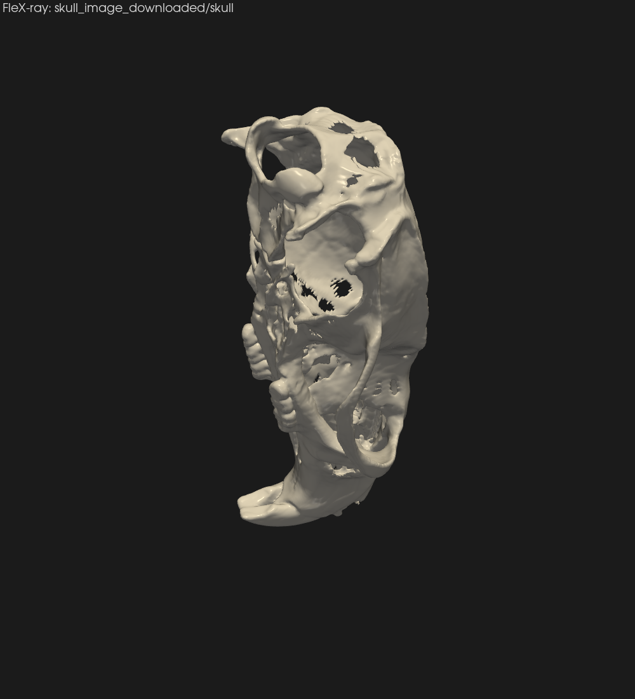
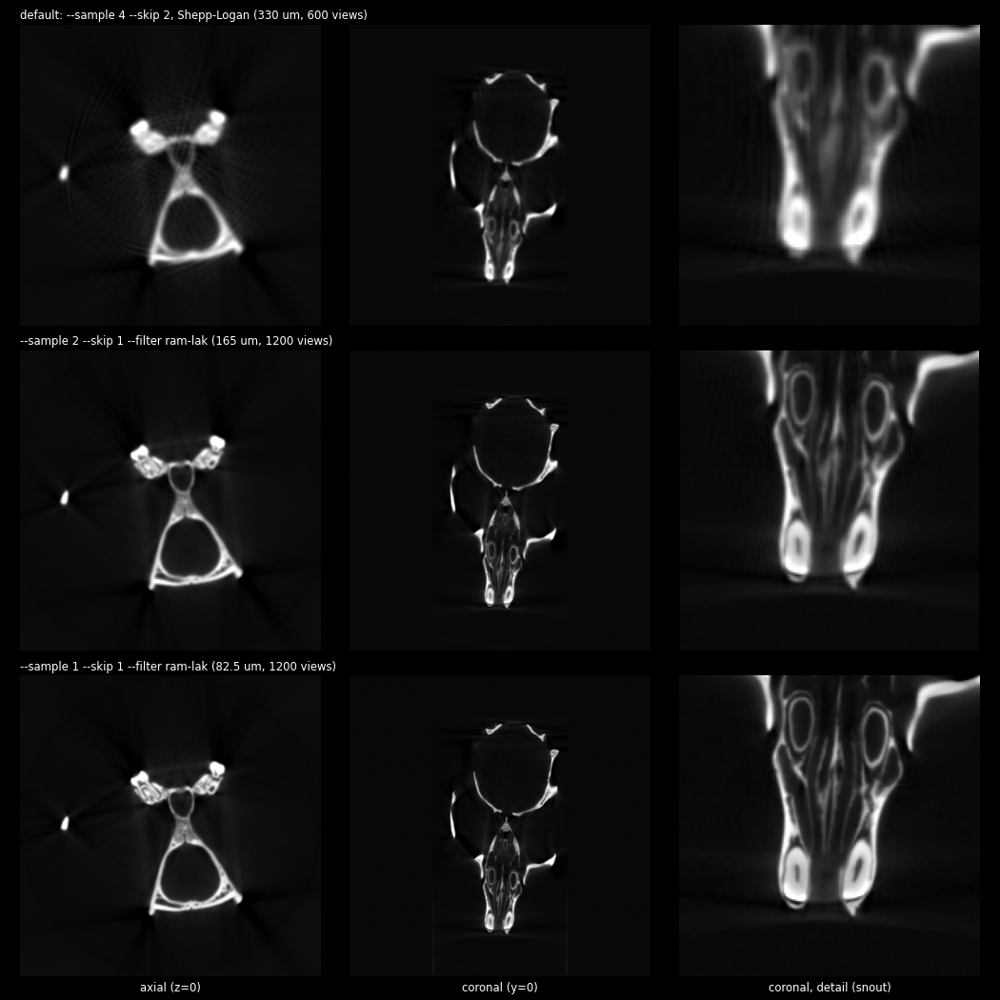
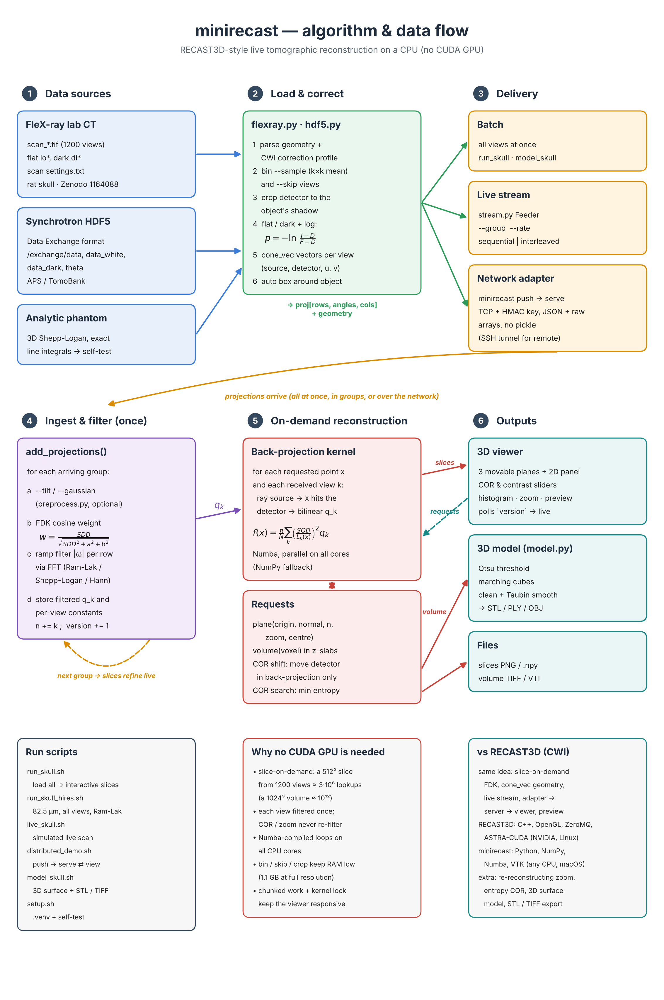

# minirecast — live tomographic slice reconstruction on the CPU

A compact Python implementation of the RECAST3D idea (real-time, slice-on-demand
tomographic reconstruction) that runs on any laptop CPU — no CUDA GPU required.

- Projections are filtered **as they arrive** (FDK for cone beam, FBP for parallel beam).
- Arbitrarily oriented slices are reconstructed **on demand** from all projections received so far, so slices sharpen live during a scan.
- 3D viewer with three movable planes plus a 2D panel. It has re-reconstructing zoom, a rotation-centre slider, contrast sliders with a histogram, and a low-resolution preview volume.
- **Adapter → server → viewer** pipeline over the network, as in RECAST3D / SliceRecon.
- Full-volume reconstruction to a **3D surface model** (STL) and a TIFF stack.
- Loaders for FleX-ray lab CT and Data Exchange HDF5 (synchrotron / TomoBank).

| 3D surface model of a rat skull (FleX-ray scan) | Speed vs resolution settings |
|---|---|
|  |  |



| RECAST3D stack | here |
|---|---|
| `recast3d` (OpenGL viewer) | `minirecast/viewer_pyvista.py` (VTK/PyVista) |
| `slicerecon` (CUDA/ASTRA slice FDK, `--preview-size`, `--gaussian`, `--tilt`) | `minirecast/recon.py` + `preprocess.py` (NumPy + Numba) |
| `tomop` packets over ZeroMQ | `minirecast/net.py` (stdlib sockets, HMAC-authenticated, no pickle) |
| adapters (FleX-ray, HDF5, TomoBank) | `minirecast push flexray/hdf5/phantom`, `flexray.py`, `hdf5.py` |

## Data
The examples use the public FleX-ray rat skull scan (CWI): 1200 cone-beam projections, about 1.7 GB.
Download it from [doi:10.5281/zenodo.1164088](https://doi.org/10.5281/zenodo.1164088) and unzip it so that
`skull_image_downloaded/skull/scan_000000.tif` exists, or set `SKULL_DIR=/path/to/skull`.

## Setup (once)
```bash
git clone https://github.com/ZYHuang216/Tomography-local-demo.git
cd Tomography-local-demo
./setup.sh          # .venv with numpy, numba, pyvista, matplotlib, tifffile, h5py; runs the self-test
```

## Run
```bash
./run_skull.sh                  # whole scan loaded, then explore (3D viewer + 2D panel)
./run_skull_hires.sh            # full detector resolution (82.5 um), sharp filter
./model_skull.sh                # 3D surface model of the skull (rotate, cut open, export STL)
./live_skull.sh                 # simulated live scan: slices refine while data arrives
./distributed_demo.sh           # adapter -> server -> viewer as three processes
```
All options: `.venv/bin/python -m minirecast flexray --help` (also `hdf5`, `phantom`, `serve`, `view`, `push`).

## Viewer
**Mouse:**
- Each slice has a handle. Drag its **sphere** to move the slice, its **arrow shaft** to push it along its normal, and its **arrow tip** to tilt it.
- Left-drag on empty space rotates the camera. The scroll wheel zooms the camera only.

**Sliders in the 3D view:**
- **Rotation centre shift** (top right): moves the rotation axis by ±10 px (`--cor-range`). The slices update when you release the slider. No re-filtering is needed, so it works during a live scan.
- **Contrast min / max** (bottom right), above them a **histogram** of the visible slice values (log counts) with the min/max lines.

**Keys:**

| key | action |
|---|---|
| `+` / `=`, `-`, `0` | zoom in at the point where the planes cross, zoom out, reset. Zoom re-reconstructs finer pixels. |
| `k` | auto-contrast (also resumes automatic contrast during a live scan) |
| `m` | next colour map (bone, gray, viridis, magma, inferno, cividis) |
| `o` | low-resolution **3D preview volume** on/off. It is recomputed in the background while data arrives. |
| `x` | automatic rotation-centre search (±3 px, minimum histogram entropy) |
| `n` | look straight at slice 1, 2, 3 in turn |
| `space` | reset the camera |
| `g` | axes indicator on/off |
| `h` | hide/show the slice handles |
| `q` | quit |

The status line at the bottom left shows projections received / total, rate, COR, backend, zoom, µm/px and the centre.

## Sharp results: resolution settings
The defaults are tuned for speed: 4× software binning (330 µm voxels), every 2nd projection, and the smooth Shepp-Logan filter. For full detail:
```bash
./run_skull_hires.sh                                   # --sample 1 --skip 1 --filter ram-lak --res 640  (82.5 um)
./run_skull.sh --sample 2 --skip 1 --filter ram-lak --res 512   # middle ground (165 um)
```
`results/resolution_comparison.png` shows the difference.
- The detector is cropped automatically to the skull's shadow. Full resolution then needs about 3 GB of RAM (`--no-crop` keeps the whole detector).
- What sets the sharpness:
  - `--sample`: detector binning. This matters most.
  - `--skip`: fewer views give streaks at high resolution.
  - `--filter`: `ram-lak` is the sharpest, `shepp-logan`/`hann` are smoother.
  - `--res`: slice pixels. Keep µm/px at or below the voxel size.
- At full resolution, check the rotation centre again with `x` or `--auto-cor`. A 0.25 px error at 4× binning is 1 px here.

## 3D model (surface instead of slices)
```bash
./model_skull.sh                         # 165 um voxels -> interactive 3D model + exports
./model_skull.sh --sample 1 --voxel 0.1  # finer
```
How it works:
1. Reconstruct the whole box as a voxel volume (FDK). This takes about a minute on an M-series Mac with Numba.
2. Set a bone/air threshold automatically (Otsu). Override it with `--iso`.
3. Extract the surface (marching cubes / VTK flying edges), drop small loose specks (`--min-piece`), and smooth it (`--smooth`).

Viewer controls:
- The slider changes the threshold (lower shows thinner bone; higher shows only dense bone and teeth).
- `l` cuts the model open with a draggable plane.
- `o` adds volume rendering.
- `space` resets the camera.

Exports go to `results/model/`:
- `skull.stl`: millimetre units. Opens in macOS Preview/Quick Look, Blender, MeshLab or a 3D-printer slicer.
- `skull_volume.tif`: a stack for Fiji/ImageJ. You can also use `.vti` for ParaView or `.npz` for Python.

Use `--decimate 0.7` for smaller files.

## Live acquisition (simulated)
```bash
./run_skull.sh --stream --order sequential --rate 50     # like a rotating stage: angles fill in
./run_skull.sh --stream --order interleaved --rate 50    # every group spans 360 deg: sharp early
```
Groups are filtered and added as they arrive (`--group`, `--rate` in projections/s). Interleaved (bit-reversed) order spreads every group over the full angular range, so a usable image appears after only a few well-spread views.

## Distributed mode (server / adapter / viewer)
```bash
.venv/bin/python -m minirecast serve --port 5558 [--gaussian 1 --tilt 0.2]       # terminal 1
.venv/bin/python -m minirecast view  --server localhost:5558                      # terminal 2
.venv/bin/python -m minirecast push  --server localhost:5558 flexray skull_image_downloaded/skull --order interleaved   # terminal 3
```
- The server binds to 127.0.0.1. For a remote compute node, use an SSH tunnel: `ssh -L 5558:localhost:5558 user@node`.
- Connections are authenticated with a shared key. Set the same `MINIRECAST_KEY` in every terminal; `distributed_demo.sh` picks a random one.

## Synchrotron data (parallel beam, Data Exchange HDF5)
TomoBank / APS-style files with `/exchange/data`, `data_white`, `data_dark` and `theta`:
```bash
.venv/bin/python -m minirecast hdf5 tomo_00001.h5 --sample 2 --rows 500:700 --auto-cor
.venv/bin/python -m minirecast push --server localhost:5558 hdf5 tomo_00001.h5 --rows 500:700
```
- Beamline data usually needs a larger rotation-centre correction than ±3 px. Widen the slider with `--cor-range 40` and drag it, or set `--cor-shift N`.
- `--rows` loads only a band of detector rows, which saves memory.

## Pre-processing (SliceRecon-style)
- `--gaussian SIGMA`: Gaussian low-pass on each projection, in detector pixels. Less noise, slightly less sharp.
- `--tilt DEG`: corrects a detector rotated by DEG degrees relative to the rotation axis.

## Saving images without the viewer
```bash
./run_skull.sh --viewer none --res 512 --save-slices results/full --snapshot results/full/skull_3d.png
./run_skull.sh --sample 2 --viewer none --zoom 3 --center=0,0,-12 --save-slices results/zoom_x3
```
With `--stream`, saving waits until the scan is complete.

## Scan and geometry (`skull_image_downloaded/skull/scan settings.txt`)
- FleX-ray lab, CWI, 20 Jul 2017. 35 kV, 1200 projections over 360°.
- Detector: 972×768 px after 2× hardware binning, 149.6 µm pixels.
- Distances: SOD 155.0 mm, SDD 281.0 mm. Voxel 82.5 µm at full resolution.
- Motor offsets are corrected with CWI's `cwi-flexray-2019-04-24` profile. The geometry matches flexDATA to 1e-13 mm, and the rotation-centre search confirms 0 extra shift.
- The default 4× binning gives 330 µm voxels. `--sample 2` gives 165 µm and `--sample 1` gives 82.5 µm.

## Files
- `minirecast/recon.py`: streaming FDK/FBP filtering, on-demand back-projection (Numba with a NumPy fallback), COR shift and search, preview volume.
- `minirecast/stream.py`: simulated acquisition (sequential or interleaved order).
- `minirecast/net.py`: server, viewer proxy and adapter sink.
- `minirecast/preprocess.py`: Gaussian and tilt correction.
- `minirecast/flexray.py`, `minirecast/hdf5.py`: data loaders.
- `minirecast/viewer_pyvista.py` (3D), `minirecast/viewer_mpl.py` (2D sliders, snapshots, slice export).
- `minirecast/selftest.py`: an analytic phantom used to check the maths. It checks streaming = batch, COR search, the HDF5 reader and the network round trip.
- `docs/`: architecture figure (`python make_fig_large.py` regenerates it).
- `results/`: example outputs. Your own runs write here; large files are git-ignored.

## References
- RECAST3D / SliceRecon / TomoPackets: https://github.com/cicwi/RECAST3D. J.-W. Buurlage et al., "Real-time quasi-3D tomographic reconstruction", *Meas. Sci. Technol.* 29 (2018) 064005.
- FleX-ray correction profiles and geometry conventions: flexDATA, https://github.com/cicwi/flexDATA.
- Data: rat skull FleX-ray scan, CWI, doi:10.5281/zenodo.1164088.
- Filtered back-projection / FDK: Kak & Slaney, *Principles of Computerized Tomographic Imaging*; Feldkamp, Davis & Kress, *JOSA A* 1 (1984).
